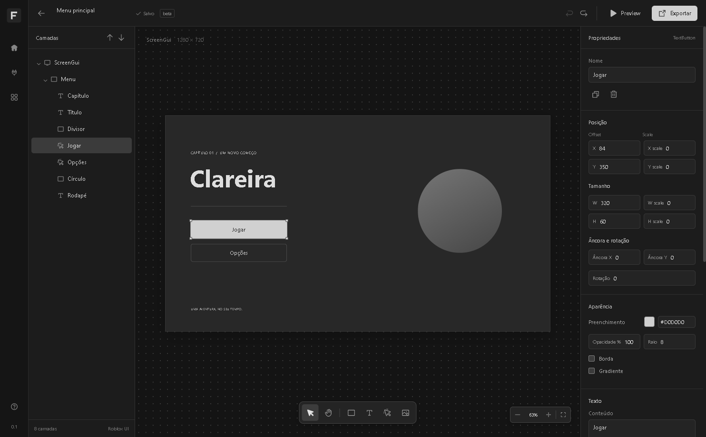

# FitaSign

Editor desktop de interfaces Roblox. Desenhe no canvas, organize camadas e exporte um ModuleScript Luau. Agentes externos editam o mesmo documento por MCP.

**0.1.0 beta · Windows x64 e Linux x64 · Apache-2.0**

Interface escura e monocromática. Canvas, camadas, inspetor e catálogo nativo de UI Roblox. [Downloads](https://github.com/AnThophicous/FitaSign/releases) · [Estado da validação](docs/status.md)



## Executar

Node.js 24 LTS e npm.

```sh
npm ci
npm run dev
```

```sh
npm run check
npm run test:e2e
npm run dist:win
# No Linux:
npm run dist:linux
```

Os instaladores ficam em `release/`. O build Windows gera instalador NSIS e executável portátil. O Linux gera AppImage e `.deb`. Cada plataforma é compilada no seu sistema pelo GitHub Actions. macOS não faz parte desta beta.

## Usar

Crie um projeto ou abra o exemplo **Menu principal**. Adicione Frame, TextLabel, TextButton ou ImageLabel; ajuste posição, tamanho, cores, cantos, stroke, gradiente e animação no inspetor. Alterações são salvas automaticamente no disco. Exporte `.fitasign` para compartilhar o projeto ou `.luau` para usar no Roblox.

**Inserir** abre o catálogo com 31 classes. O inspetor permite buscar propriedades Roblox: são 730 entradas entre as classes e 544 escolhas de enums. ScrollingFrame, TextBox, layouts, constraints, UIShadow e outros modificadores são preservados na exportação. Veja [o catálogo e os limites do preview](docs/roblox-catalog.md).

O Luau exportado é um ModuleScript. Depois de inseri-lo no jogo:

```lua
local buildUI = require(caminho.para.Menu)
buildUI(game.Players.LocalPlayer:WaitForChild("PlayerGui"))
```

O exportador cria os elementos e tweens. Conecte os eventos dos botões no código do jogo.

## Agentes externos

O aplicativo não inclui um assistente. Codex, Claude, OpenCode e outros clientes MCP podem controlar o documento usando o servidor stdio distribuído com o FitaSign. Abra **Conexões** para copiar a configuração local. Veja [MCP](docs/mcp.md), [AGENTS.md](AGENTS.md) e a [skill de composição](skills/fitasign-ui/SKILL.md).

## Limites da beta

O canvas aproxima a renderização Roblox com HTML/CSS. Fontes, rasterização, recorte de cantos com filhos e UIGradient em texto podem diferir; confira o resultado no Studio. Listas e grids simples têm preview; flex avançado, paginação, fontes remotas, blur, sombras nativas, vídeo e cenas 3D são configurados e exportados para validar no Studio. Imagens usam IDs `rbxassetid://`; a beta exporta o ID e mostra um marcador local, sem baixar o asset. Animações disponíveis: fade e entrada vertical. Não há sincronização automática com Studio, edição vetorial, colaboração ou componentes reutilizáveis nesta versão.

O executável Windows é distribuído sem assinatura de código. A beta não inclui atualizador automático. Abra apenas arquivos de projeto de origem conhecida e mantenha o app atualizado.

## Desenvolvimento

[Arquitetura](docs/architecture.md) · [Decisões de interface](docs/design.md) · [Contribuição](CONTRIBUTING.md) · [Notas da versão](CHANGELOG.md)
